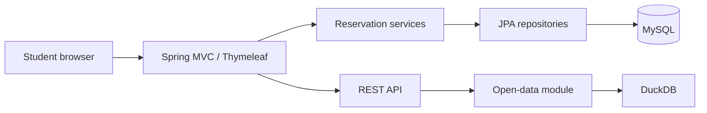

# UniRoom — University Study Room Reservations

## Project description

UniRoom is a university study-room reservation application created for a semester software engineering project. Students can consult rooms, log in with an institutional code, make reservations, see their reservations, and join a waiting list when a room is unavailable. The main goal is to prevent booking conflicts and organize university spaces. The software includes web pages and REST endpoints; it is an academic project, not an official university service.

## Technology and architecture

The application uses Java 21, Spring Boot, Maven, Thymeleaf and Hibernate/JPA. MySQL stores students, rooms, time slots, reservations and waiting-list entries. Flyway controls database migrations. JUnit and MockMvc support testing. An open-data module uses HTTP adapters, a circuit breaker, and DuckDB to analyze Colombian public data. The code maintains the ports-and-adapters approach introduced in a previous laboratory session.

The presentation layer receives browser requests, service classes process reservation rules, and repositories access the database. Versioned SQL migration scripts create the required tables. The open-data module works independently of the reservation database. This separation makes the code easier to understand, test and maintain.

## Docker and local execution

A multi-stage Dockerfile compiles the Java application in a Maven image and runs it in a smaller Java runtime image as a non-root user. The `.dockerignore` excludes unnecessary files. Docker Compose defines two containers: the application and MySQL 8. It uses environment variables for credentials, a persistent database volume and health checks.

To try it, install Docker Desktop, copy `.env.example` to `.env` and replace both sample passwords. Execute `docker compose up --build -d`. Visit `http://localhost:8080/login` and use `docker compose ps` to check service health. The command `docker compose logs app` shows application messages. To stop everything, run `docker compose down`. A new MySQL database initially has no rooms or students, so it may require demonstration records before testing complete booking flows.

## Four-stage CI/CD process

The GitHub Actions workflow in `.github/workflows/ci-cd.yml` has four jobs. **Test** launches MySQL and runs Maven automated tests. **Build** packages an executable Java JAR. **Push** publishes the container image to Docker Hub. **Deploy** uploads the current Dockerfile project to an existing Railway application service. The push and deploy jobs run for the main branch, while pull requests execute test and build.

To activate these stages, add four repository secrets: `DOCKERHUB_USERNAME`, `DOCKERHUB_TOKEN`, `RAILWAY_TOKEN` and `RAILWAY_SERVICE_ID`. Create a Railway MySQL service and an application service. Set `UNIROOM_DB_URL`, `UNIROOM_DB_USER` and `UNIROOM_DB_PASSWORD` in the application using the actual MySQL connection details. Railway can provide a public domain for the application. Do not store database passwords or access tokens in Git.

## Testing and quality

The original Guide 6 archive included historical Surefire reports showing 23 tests with no failures or errors. They cover queue operations, API validations, database migration, concurrency and repository behavior. These old reports do not prove that the current Docker image or final pipeline works. Execute GitHub Actions, inspect the logs, and collect screenshots of the four successful stages before submitting the final project. Measure Docker image sizes only after building real images.

## Security, evidence and final demonstration

The uploaded version authenticates students using HTTP sessions and hashed passwords. **JWT and role-based permissions are not implemented in this Guide 6 source.** Do not claim they work without integrating and verifying the newer source. GitHub Copilot can assist with development, but its proposed code must be checked and corrected if needed. Record one real Copilot suggestion and explain the correction.

The final group presentation should show the working application, database, container status, Docker Hub image, GitHub Actions results and public Railway URL. The executive Word report needs APA 7 references, four guiding answers, evidence and links to GitHub and the English video. The video must last between one and three minutes. Only use real evidence: files being configured is not the same as a completed deployment.
