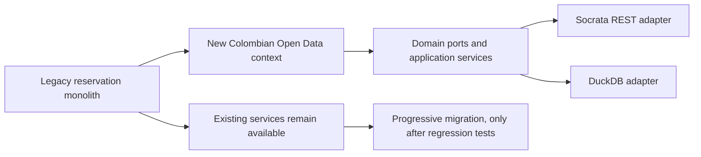

# Session 11: The Strangler Fig Pattern (application to UniRoom)

| Criterion | Modular monolith | Microservices |
|---|---|---|
| Deployment | One process | Multiple independent processes |
| Cost | Lower infrastructure overhead | Higher infrastructure/operations cost |
| Isolation | In-process modules | Network and deployment isolation |
| Data transactions | Simpler | Distributed consistency challenges |
| Best fit for UniRoom today | Yes | No, until scale justifies it |

# Session 12: API Consumption Guide

- **Source A:** `GET https://www.datos.gov.co/resource/n5yy-8nav.json?$limit=100` (higher education institutions).
- **Source B:** `GET https://www.datos.gov.co/resource/y9ga-zwzy.json?$limit=100` (enrollment by municipality).
- **Authentication:** no token needed for these public endpoints at modest request volume; API providers may impose throttling.
- **Parameters:** `$limit`, from 1 to 500 in UniRoom's endpoint.
- **Expected response:** JSON array of object records; exact keys are source-dependent.
- **Error handling:** HTTP timeout, three attempts with exponential backoff, then a CLOSED / OPEN / HALF_OPEN circuit breaker.
- **Privacy:** use public aggregate/institutional data and avoid collecting, re-identifying or exposing personal data under Colombian Law 1581 of 2012.
- **Example:** `GET /api/v1/datos-colombia/n5yy-8nav/estadisticas?limit=100` returns `fuente`, `registros`, `circuitBreaker` and `estadisticas`.
- **Critical review of Copilot (example to verify with a real suggestion):** A simple HTTP GET is insufficient for outages. Inspect generated code for missing timeouts and retries, then add tests and circuit state transitions. Do not claim this suggestion was actually generated without evidence.
